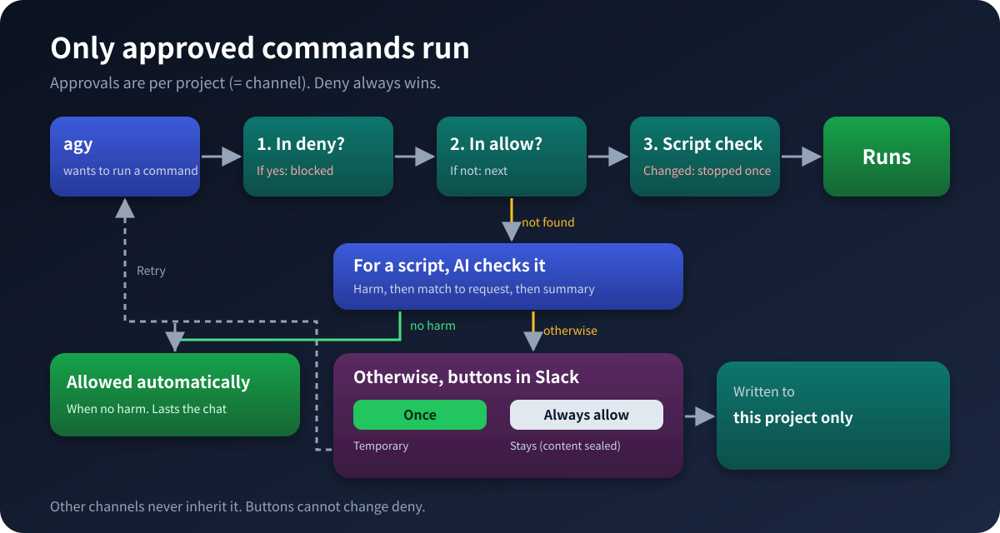
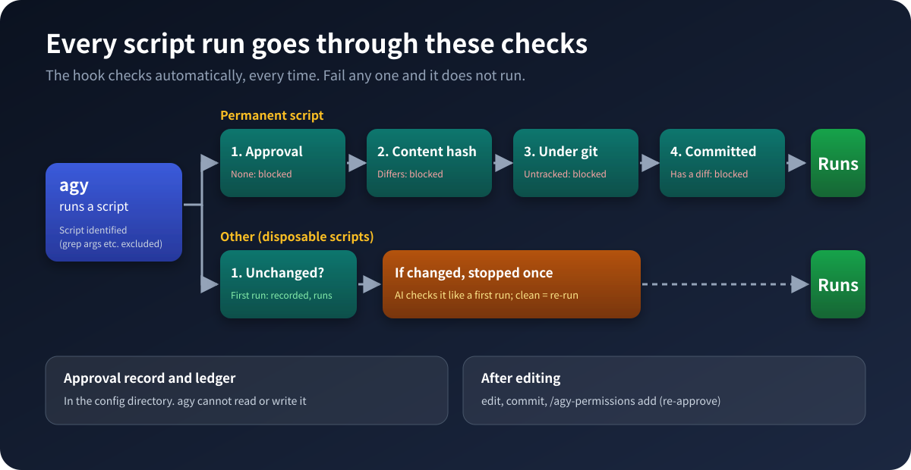

# How Execution Permissions Work

For how to operate permissions from Slack, see "Managing permissions from Slack" in [usage.en.md](usage.en.md).

## 1. Permission layers

| Layer | Location | Contents | Scope |
|---|---|---|---|
| Project permissions | `permissionGrants.permissionGrants.allow` in `~/.gemini/config/projects/<id>.json` | Entries such as `command(...)` and `read_url(...)` | That project (= that Slack channel) only |
| Temporary grants | The bridge's state DB (`temp_grants`) | Same kind of entries | Valid only for the duration of that conversation. Removed automatically once turns succeed |
| Permanent-grant ledger (optional) | `integrity/<project key>/permanent.json` in the config directory | A sha256 per script (seal) | That project only |
| agy's own allow/deny lists | `permissions.allow` / `deny` and `trustedWorkspaces` in `~/.gemini/antigravity-cli/settings.json` | Same kind of entries, or absolute paths | All of agy (the bridge does **not** write here) |

**The bridge writes only to the project's `permissionGrants` (and, for scripts, the ledger `permanent.json` in the config directory).** Both temporary and permanent grants are written only to the file of the project that the channel is linked to. You are free to edit agy's own `settings.json` yourself (or through operations of the `agy` command itself), and it is fine to leave `trustedWorkspaces` and `deny` there. What this means is that the bridge has no feature that creates a grant that applies across all projects.

### Why permissions are per project

If a permission is written to `permissions.allow` in `settings.json`, it applies to all of agy's projects (= all Slack channels). For example, if you allow `aws logs filter-log-events` in channel A, the same command can be executed without a prompt from conversations in channel B. When we actually operated it this way, commands and MCP tools meant for one project turned out to be usable from other projects as well. For that reason, all permissions are now written to the `permissionGrants` of the relevant project.

Several projects may use the same script (such as `gdrive_cli.py`), but that is a state in which **each project allows that command separately**; they do not reference a single shared list. Adding a new project does not inherit any permissions from other projects (you start granting from scratch).

## 2. How matching works

- `command(git diff)` matches if the leading tokens match. `git diff --stat` and `git diff HEAD~1` both pass. `git diffX` and `git status` do not.
- Appending `*` at the end does not reliably work. Do not write it.
- For compound commands (`&&`, `;`), each subcommand is matched individually. `echo hi && touch x` is rejected as a whole unless `touch` is allowed.
- deny takes precedence over allow.
- If a single line mixes allowed and denied parts, the whole line is rejected.

## 3. Permission granularity (guidelines)

- Subcommand level is the basic unit. A broad entry such as `command(aws logs)` would also let deletion-type commands through. Write only the read operations individually, as in `command(aws logs get-log-events)`.
- Do not allow the following.
  - Interpreters themselves (`python3`, `node`, `bash`, etc.).
  - Execution of arbitrary packages via package runners (`npx`, `uvx`, etc.).
  - Task-runner wildcards (`npm run *`, `make *`, etc.).
  - Write-type commands such as `gh api`, `docker exec`, `sudo`, `rm`, and `git push`.
- Read-only scripts with fixed arguments (e.g. `scripts/foo.py`) may be allowed by prefix. However, if the script lets you pass the output destination as an argument, fix the output destination first.
- `read_url(domain)` works per domain. Since it is a read-only tool, it is relatively safe to allow in bulk the known domains used by that project (e.g. `arxiv.org` for a research project).

## 4. Temporary grants and permanent grants

- The approval button on a denied action (「許可して再実行」) is a temporary grant for that conversation; it writes immediately to the **project's** `permissionGrants.allow`, and is also recorded in the bridge's state DB (`temp_grants`, per conversation).
  - It is not removed after a single failure. It is removed when that conversation ends without errors (a clean turn), provided no other conversation in the same project still needs it.
  - It is also removed if the conversation has been inactive for 1 hour (`AGY_TEMP_GRANT_MAX_AGE_SEC`) or more (with the same check of whether anything else in the same project is using it).
- A permanent grant is made with `/agy-permissions add`, not with a button. It leaves the entry written in the same **project's** `permissionGrants.allow`. For a script, a seal is also stored in the ledger `permanent.json` in the config directory.
- The number of times each grant is used is recorded in `permission_log`. You can view it with `/agy-permissions stats` (recording is toggled by `permission_stats` under `telemetry`).
- Stall detection (silent denial): a `run_command` for which agy finishes with "DONE, no output" can be misjudged as a denial. If it matches an already-allowed entry, it is not treated as a denial.

## 5. Permanently allowed scripts (seal)

The ledger `<config directory>/integrity/<project key>/permanent.json` has the format `{ "<absolute path of script>": "<sha256>" }`. It is a separate file for each project, and it is placed not inside the project but in the config directory, which the agent cannot read or write (the key is a hash of the real path of the project root).

- **seal**: Writes the hash of the content at the time of approval. The bridge writes it automatically on `/agy-permissions add`. Sending the same `add` again rewrites the hash with the current content (re-seal).
- **Hook decision** (agy's global `PreToolUse` hook; registered by `tools/install.py` and active only for projects set up with `setup_agy_project.py`):
  - A permanently allowed script passes only if its hash matches and it is committed in git with no diff.
  - Even if it is committed, it is rejected when the hash differs. A commit does not count as approval.
- **Temporary scripts** (not permanently allowed): the first content seen is recorded in the ledger (`hashes.json` in the same location). If the content has changed later, the script is rejected once with a diff attached, and the ledger is updated. Sending the same instruction again lets it through. git is not required.
- If you gitignore a working directory (e.g. `scratch/`), scripts there cannot be permanently allowed (they cannot satisfy the git clean requirement). If you want to allow one permanently, move it to somewhere like `scripts/`, commit it, and then seal it.

### Order of operations

1. Edit the script.
2. Commit it (the hook requires a clean state).
3. Send `/agy-permissions add` again to re-seal.

### Automatic check before the permission button (AI)

When a command that would get a permission button runs a script, the bridge first starts separate agy conversations to check the script in 3 stages. **The button is shown at every stage** (a person decides); the check only supplies material for that decision.

1. **Does it do anything harmful? (always)**: looks for file writes or deletes, reads outside the project or of credential files, external calls other than `gdrive_cli.py`, running other programs, `eval` or obfuscation. If there is none, even a script that strays from the request cannot do damage, so it ends here ("no harmful operation found", then the button).
2. **Does it match the request? (only if stage 1 found something)**: compares the script with the user's request and decides whether it does only what the request needs. If so, the button.
3. **Show summary and content (only if stage 2 says no)**: a summary of up to 3 lines and the script's content (first 2,500 characters) are shown in Slack, with the button. Per channel, this can be turned off: in the channel settings of the setup script (menu 6), answer `n` to `依頼と合わなそうなスクリプトの、要約と内容を表示しますか?` and only the reasons are shown (`script_summary: false`).

Each stage is a separate agy call, run without `--project`, in an empty temporary directory, in plan mode, so no project permissions apply. The script is passed as data inside a random delimiter, with instructions not to follow anything written in it.

**Limits**: it is an AI verdict. A clever script may fool it, and "not found" is not a guarantee of safety. Scripts over about 60 KB are checked only up to the first 60 KB, and the message says so. If the check fails (e.g. times out), the button is still shown with a note that it was not checked. This is not a per-run check of already-allowed scripts (that is the hook above).

## 6. MCP tools

MCP tools are allowed by per-server tool name. This is finer-grained than a `run_command` prefix permission. Do not allow tools that execute arbitrary code. As with other entries, permissions are per project (for example, `mcp(playwright/...)` for browser operation should be allowed only in the projects that need it).

## 7. How to check

- `/agy-permissions list`: The `permissionGrants.allow` of **the project of the channel you are in**. Entries from other projects are neither visible nor included.
- `/agy-permissions stats [days]`: In this channel, ordered by how often permission was requested.
- `/agy-stats buttons [days]`: The same content, shown together with button outcomes (once, permanent, denied).

## 8. When adding a new project

Immediately after you add a new project (= a new Slack channel) to `config.yaml`, that project's `permissionGrants.allow` is empty. No permissions from any other existing project are inherited. It is normal for the permission buttons to appear frequently the first few times; if you make each one permanent with `/agy-permissions add`, a permission list dedicated to that project will grow.

## 9. When a safety mechanism is missing

Before every `agy` call (and at startup), the bridge checks that the following safety mechanisms are in place. Whatever is missing is **put back automatically, with the same content setup would create** ("auto-repair"). If something that cannot be put back remains, the bridge **does not run `agy`** and replies to Slack with what is missing.

| What is checked | Example of what is missing |
|---|---|
| The project has `.agents/rules/agent-safety-rules.md`, starting with `trigger: always_on` (without it agy ignores the file) | Deleted file, broken link, missing frontmatter |
| The `script-integrity` hook is registered in `~/.gemini/config/hooks.json` and its script exists in the install directory | Removed registration, damaged install directory |
| The hook's state directory (`integrity/<key>/` in the config directory) exists | Deleted config directory, project not set up |
| `permissions.deny` in `settings.json` contains `write_file(...)` for the install directory and the config directory | Removed deny rules |

Only **presence** is checked. It does not stop you from deliberately loosening the allowed folders or the contents of the safety rules. For agy's built-in project without a workspace, the project-side checks (rules, state directory) are skipped.

**What auto-repair covers**

| Missing | Auto-repair |
|---|---|
| The safety rules file / a broken link | Re-creates the link to `agent-safety-rules.md` in the install directory |
| The hook's state directory | Re-creates it |
| The hook registration | Registers it again in `hooks.json` (other hooks are kept) |
| `deny` | Adds to `permissions.deny` in `settings.json` (other entries are kept; no `allow` is ever written) |
| The safety rules file lacks `trigger: always_on` (agy ignores it otherwise) | Only the `trigger: always_on` line is fixed (added to the top if there is no frontmatter, or the `trigger` line is rewritten if it has another value; nothing else changes). A symlink pointing elsewhere is not edited: `agy` is not run and it is reported |
| `script_integrity.py`, `hooks.json` or `agent-safety-rules.md` in the install directory is gone | Restored from the original that `install.py` saved in `safety-backup/` in the config directory (the agent cannot read or write the config directory). Without a backup (an old install) it cannot be repaired: run `install.py` again |

When something is repaired, the bridge logs a warning and posts a notice to the channel: "Missing safety mechanisms were repaired automatically. Someone may have deleted them." Something disappearing is itself a sign of trouble, so it is never repaired silently.
