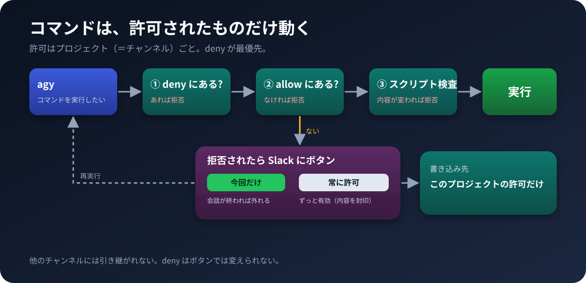
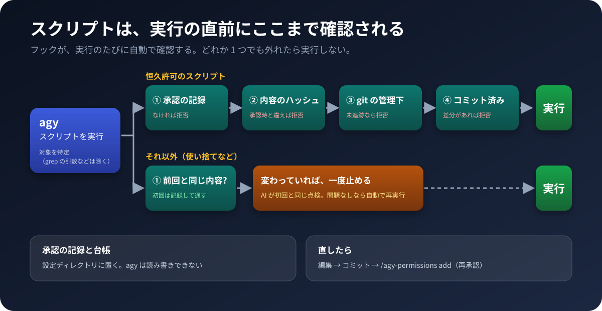

# 実行許可の仕組み

Slack からの操作方法は [usage.md](usage.md) の「Managing permissions from Slack」を参照。

## 1. 許可の層

| 層 | 場所 | 中身 | 範囲 |
|---|---|---|---|
| プロジェクトの許可 | `~/.gemini/config/projects/<id>.json` の `permissionGrants.permissionGrants.allow` | `command(...)` や `read_url(...)` などのエントリ | そのプロジェクト（＝Slackチャンネル）だけ |
| 一時許可 | bridge の state DB（`temp_grants`） | 同上のエントリ | その会話の間だけ有効。成功が続いたら自動で外れる |
| 恒久許可の台帳（任意） | 設定ディレクトリの `integrity/<プロジェクトのキー>/permanent.json` | スクリプトごとの sha256（seal） | そのプロジェクトだけ |
| agy 自身の許可/拒否リスト | `~/.gemini/antigravity-cli/settings.json` の `permissions.allow` / `deny`、`trustedWorkspaces` | 同上のエントリ、または絶対パス | agy 全体（bridge はここを**書かない**） |

**bridge が書き込むのは、プロジェクトの `permissionGrants`（と、スクリプトなら設定ディレクトリの台帳 `permanent.json`）だけ。** 一時許可も恒久許可も、どちらもそのチャンネルが紐づくプロジェクトのファイルにしか書かない。agy 自身の `settings.json` は、あなたが手で（あるいは `agy` コマンド自体の操作で）編集する分には触れるし、`trustedWorkspaces` や `deny` はそこに置いたままでよい ― bridge の機能としては、どのプロジェクトにも共通で効くような許可を作る経路が無い、という意味。

### なぜプロジェクト単位にしたか

許可を `settings.json` の `permissions.allow` に書くと、agy の全プロジェクト（＝全Slackチャンネル）に共通で効いてしまう。たとえばチャンネルAで `aws logs filter-log-events` を許可すると、チャンネルBの会話からも同じコマンドが素通りで実行できる。実際にこの形で運用したところ、あるプロジェクト専用のコマンドや MCP ツールが、別のプロジェクトからも使える状態になっていた。そのため、許可はすべて、該当プロジェクトの `permissionGrants` に書く方式にした。

複数のプロジェクトが同じスクリプト（`gdrive_cli.py` など）を使うことはあるが、それは**各プロジェクトが別々にそのコマンドを許可している**状態であって、1つの共有リストを参照しているわけではない。新しいプロジェクトを増やしても、他プロジェクトの許可を一切引き継がない（ゼロから許可し直しになる）。

## 2. マッチの仕方

- `command(git diff)` は、先頭のトークンが一致すれば通る。`git diff --stat` も `git diff HEAD~1` も通る。`git diffX` や `git status` は通らない。
- 末尾に `*` を付けても、確実には効かない。書かないこと。
- 複合コマンド（`&&`、`;`）は、各サブコマンドを個別に照合する。`echo hi && touch x` は、`touch` が許可されていなければ全体が拒否される。
- deny は allow より優先される。
- 1 行の中で許可されたものと拒否されたものが混ざると、全体が拒否される。

## 3. 許可の粒度（指針）

- サブコマンド単位が基本。`command(aws logs)` のように広く取ると、削除系も通ってしまう。`command(aws logs get-log-events)` のように、読み取りだけを個別に書く。
- 次は許可しない。
  - インタープリタ（`python3`、`node`、`bash` など）そのもの。
  - パッケージランナー（`npx`、`uvx` など）の、任意パッケージの実行。
  - タスクランナーのワイルドカード（`npm run *`、`make *` など）。
  - `gh api`、`docker exec`、`sudo`、`rm`、`git push` などの書き込み系。
- 決まった引数の読み取り専用スクリプト（例: `scripts/foo.py`）は、プレフィックスで許可してよい。ただし、そのスクリプトに出力先を引数で渡せるなら、先に出力先を固定する。
- `read_url(ドメイン)` はドメイン単位。読み取り専用ツールなので、そのプロジェクトで使う既知のドメイン（例: 研究用プロジェクトなら `arxiv.org` など）をまとめて許可しておくのは比較的安全。

## 4. 一時許可と恒久許可

- 拒否された操作に付く承認ボタン「許可して再実行」は、その会話の間だけの一時許可で、その**プロジェクトの** `permissionGrants.allow` に即座に書かれ、同時に bridge の state DB（`temp_grants`、会話単位）にも記録される。
  - 1 回失敗しても外さない。その会話が「エラーなし」で終わった（clean turn）時点で、同じプロジェクトの他の会話がまだ必要としていなければ外す。
  - 会話が 1 時間（`AGY_TEMP_GRANT_MAX_AGE_SEC`）以上動いていない場合も、外す（同じ「同一プロジェクト内で他に使ってないか」の確認付き）。
- 恒久許可は、ボタンではなく `/agy-permissions add` で行う。同じ**プロジェクトの** `permissionGrants.allow` に書かれたままになる。スクリプトなら、設定ディレクトリの台帳 `permanent.json` に seal も入る。
- 使われた回数は、`permission_log` に記録される。`/agy-permissions stats` で見られる（記録は `telemetry` の `permission_stats` で切り替え）。
- 停滞の検知（silent denial）: agy が「DONE・出力なし」で終わった `run_command` は、拒否と誤判定されうる。すでに許可済みのエントリと一致する場合は、拒否扱いしない。

## 5. 恒久許可のスクリプト（seal）

台帳 `<設定ディレクトリ>/integrity/<プロジェクトのキー>/permanent.json` は、`{ "<スクリプトの絶対パス>": "<sha256>" }` の形式。プロジェクトごとに別のファイルで、プロジェクトの中ではなく、エージェントが読み書きできない設定ディレクトリに置かれる（キーは、プロジェクトのルートの実パスのハッシュ）。

- **seal**: 承認した時点の内容のハッシュを書く。bridge は `/agy-permissions add` の時に自動で書く。同じ `add` をもう一度送ると、ハッシュは今の内容で書き直される（再 seal）。
- **フックの判定**（agy のグローバルな `PreToolUse` フック。`tools/install.py` が登録し、`setup_agy_project.py` でセットアップしたプロジェクトにだけ働く）:
  - 恒久許可のスクリプトは、ハッシュが一致し、かつ git でコミット済み・差分なしの時だけ通す。
  - コミットされていても、ハッシュが違えば拒否する。コミットは承認にならない。
- **一時的なスクリプト**（恒久許可ではない）: 初回の内容を台帳（同じ場所の `hashes.json`）に記録する。後で内容が変わっていたら、差分を付けて一度だけ拒否し、台帳を更新する。もう一度同じ指示を送れば通る。git は要らない。
- 作業用ディレクトリ（例: `scratch/`）を gitignore しているなら、そこのスクリプトは恒久許可にできない（git の clean を満たせない）。恒久許可にしたいなら、`scripts/` などに移してコミットしてから seal する。

### 運用の順番

1. スクリプトを編集する。
2. コミットする（フックは clean を要求する）。
3. `/agy-permissions add` をもう一度送って再 seal する。

### 許可ボタンの前の自動チェック（AI）

許可ボタンを出すコマンドがスクリプトを実行するものなら、ボタンを出す前に、bridge が別の agy の会話を立ち上げて、スクリプトの中身を 3 段階で点検します。どの段階でも、**ボタンは出ます**（許可するかどうかは人が決めます）。点検は、判断の材料を出すためのものです。

1. **実害の出る操作があるか（常に実行）**: ファイルの書き込み・削除、プロジェクトの外や認証情報のファイルの読み取り、`gdrive_cli.py` 以外の外部通信、他のプログラムの実行、`eval` や難読化、を探します。無ければ、依頼と多少ずれていても被害は出ないので、ここで終わりです（「実害の出る操作は見つかりませんでした」と表示してボタン）。
2. **依頼どおりか（1 で見つかったときだけ）**: スクリプトとユーザーの依頼文を突き合わせて、依頼に必要な処理だけをしているかを判定します。問題なければ、そのままボタンです。
3. **要約と内容の表示（2 で問題ありとされたときだけ）**: 3 行以内の要約と、スクリプトの内容（先頭 2,500 文字まで）を Slack に表示して、ボタンを出します。チャンネルごとにオフにできます。セットアップのチャンネルの設定（メニュー 6）で、`依頼と合わなそうなスクリプトの、要約と内容を表示しますか?` に `n` と答えると、理由だけが表示されます（`script_summary: false`）。

各段階は、別々の agy の呼び出しです。`--project` なし、空の一時ディレクトリ、plan モードで動かすので、プロジェクトの許可は使いません。スクリプトの中身は、ランダムな区切りで囲んだ「データ」として渡し、中の指示に従わないよう指示しています。agy が呼び出しごとに残す会話のファイル（`~/.gemini/antigravity-cli/` の `brain`・`conversations`・`annotations`・`presence`）は、呼び出しのたびに削除します。

**限界**: AI の判定です。巧妙なスクリプトに騙される可能性はあり、「見つかりませんでした」は安全の保証ではありません。約 60 KB を超えるスクリプトは先頭のみ点検し、その旨を表示します。点検に失敗したとき（タイムアウトなど）も、ボタンは出し、「自動チェックできませんでした」と表示します。許可済みのスクリプトを実行のたびに検査するわけではありません（実行時の検査は上のフックです）。

## 6. MCP ツール

MCP ツールは、サーバーごとのツール名で許可する。`run_command` の prefix 許可より粒度が細かい。任意コードを実行するツールは、許可しない。プロジェクト単位である点は他のエントリと同じ（たとえば、ブラウザ操作用の `mcp(playwright/...)` は、必要なプロジェクトにだけ許可する）。

## 7. 確認方法

- `/agy-permissions list`: **今いるチャンネルのプロジェクト**の `permissionGrants.allow`。他プロジェクトのものは見えない・含まれない。
- `/agy-permissions stats [日数]`: このチャンネルで、許可を求められた回数の多い順。
- `/agy-stats buttons [日数]`: 同じ内容を、ボタンの結果（今回・恒久・拒否）つきで表示。

## 8. 新しいプロジェクトを増やすとき

新しいプロジェクト（＝新しいSlackチャンネル）を `config.yaml` に追加した直後は、そのプロジェクトの `permissionGrants.allow` は空。既存の他のプロジェクトの許可は一切引き継がれない。最初の数回は許可ボタンが頻発するのが正常な動作で、その都度 `/agy-permissions add` で恒久許可していけば、そのプロジェクト専用の許可リストが育っていく。

## 9. 安全機構が欠けているとき

bridge は、`agy` を呼ぶたびに（と起動時に）、次の安全機構が揃っているかを確認します。欠けているものは、**セットアップが作るものと同じ内容で、自動的に戻します**（「自動修復」）。戻せないものが残っていれば、**`agy` を実行せず**、欠けているものを Slack に返信します。

| 確認する内容 | 欠ける例 |
|---|---|
| プロジェクトの `.agents/rules/agent-safety-rules.md` があり、先頭に `trigger: always_on` がある（無いと agy が無視する） | ファイルの削除、リンク切れ、frontmatter の欠落 |
| フック `script-integrity` が `~/.gemini/config/hooks.json` に登録され、スクリプトがインストール先にある | 登録の削除、インストール先の破損 |
| フックの状態ディレクトリ（設定ディレクトリの `integrity/<キー>/`）がある | 設定ディレクトリの削除、未セットアップ |
| `settings.json` の `permissions.deny` に、インストール先と設定ディレクトリへの `write_file(...)` がある | deny の削除 |

確認するのは**存在**だけです。許可フォルダや安全規則の内容を、意図して緩めることは妨げません。ワークスペースのない agy 組み込みのプロジェクトには、プロジェクト側の確認（規則・状態ディレクトリ）を行いません。

**自動修復の範囲**

| 欠けているもの | 自動修復 |
|---|---|
| 安全規則のファイル／リンク切れ | インストール先の `agent-safety-rules.md` へのリンクを作り直す |
| フックの状態ディレクトリ | 作り直す |
| フックの登録 | `hooks.json` に登録し直す（他のフックは残す） |
| `deny` | `settings.json` の `permissions.deny` に足す（他の項目は残す。`allow` は書かない） |
| 安全規則の先頭に `trigger: always_on` が無い（無いと agy が無視する） | `trigger: always_on` の行だけを直す（frontmatter が無ければ先頭に足し、`trigger` が別の値ならその行を書き換える。ほかの内容は変えない）。ほかの場所を指すシンボリックリンクは編集せず、`agy` の実行を止めて報告する |
| インストール先の `script_integrity.py`・`hooks.json`・`agent-safety-rules.md` が消えた | `install.py` が設定ディレクトリの `safety-backup/` に控えた原本から戻す（設定ディレクトリはエージェントが読み書きできない）。控えが無い（古いインストール）と直せないので、`install.py` を再実行する |

修復したときは、bridge のログに警告を出力し、そのチャンネルに「欠けていた安全機構を自動で修復しました。誰かが削除した可能性があります」と通知します。消えたこと自体が異常のしるしなので、黙って直すことはしません。
